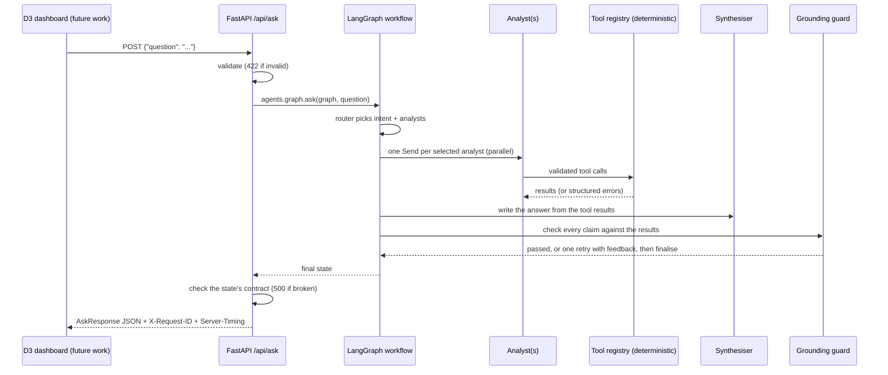

# API workflow (Stage 8)

The API puts the Stage 7 LangGraph workflow behind HTTP, so the D3 dashboard can later send a question and get back a checked answer along with the evidence behind it. It adds validation, error responses, CORS, request ids and timing headers. It doesn't analyse anything itself: every number comes from the deterministic tools, through the existing graph.

The code lives in `agent-backend/app/`, which is the package the project had already set aside for it:

- `main.py` holds the app factory and routes.
- `schemas.py` holds the request and response models, plus the state-to-response conversion.
- `config.py` holds the settings.
- `offline.py` holds the offline mock LLM.

## How a request flows



Inside the graph:

- The **router** decides what kind of question it is and which analysts handle it.
- Each **analyst** chooses tool calls, which are validated and run through the **tool registry**.
- The **synthesiser** writes the answer, using only those results.
- The **grounding guard** checks every number and claim.

See `graph-workflow.md` for the details.

## Endpoints

| method | path | what it does |
|---|---|---|
| GET | `/health` | Is the process up? Returns `{"status": "ok", "service", "version"}`. Checks nothing else. |
| GET | `/health/ready` | Is the compiled graph present and the match data loadable? Returns 200 `ready` or 503 `not_ready` with per-check results. It never calls the LLM or a tool. |
| POST | `/api/ask` | Answers one question. |
| GET | `/docs`, `/redoc`, `/openapi.json` | Generated API docs. |

## Request

```json
{"question": "Do yellow cards cost teams points?"}
```

`question` is required and must be a string. Whitespace is collapsed, as in `new_state`, and the result must be 1 to 1000 characters (`MAX_QUESTION_CHARS` in `agents/state.py`). Any other field is rejected. In particular there's no `thread_id`: with a checkpointer, reusing a thread id would merge one run's tool results into the next, and conversations are not part of this stage. Request bodies over 16 KB get a 413.

## Response

This is an abridged real response from the offline mock. No live LLM was involved: the answer text is the correlation tool's own summary.

```json
{
  "request_id": "demo-1",
  "question": "Do yellow cards cost teams points?",
  "outcome": "verified",
  "verified": true,
  "answer": "Weak negative pearson correlation between AvgYellowCards and Points (r = -0.207, n = 2224, p < 0.001); statistically significant at the 5% level. Correlation does not establish causation.",
  "evidence": ["Weak negative pearson correlation between AvgYellowCards and Points (r = -0.207, ...)"],
  "key_stats": [],
  "explanation": "Offline mode: no language model is configured, so this answer is assembled from the analysis tools' own summaries.",
  "grounding": {"passed": true, "checked": 8, "unsupported": [], "issues": []},
  "retries": 0,
  "intent": "discipline",
  "analysts": ["discipline"],
  "tool_results": [{"call_id": "discipline-1", "analyst": "discipline", "tool": "correlation_analysis",
                    "args": {"x_metric": "AvgYellowCards"}, "ok": true,
                    "result": {"r": -0.20670326748847873, "n": 2224, "...": "full tool output"}, "error": null}],
  "chart_actions": [],
  "warnings": ["Premier League 2018-19 is incomplete in the source data (210 of 380 matches); season totals are partial.", "..."],
  "errors": [],
  "usage": {"llm_calls": 3, "prompt_tokens": 3296, "completion_tokens": 200, "total_tokens": 3496,
            "llm_latency_ms": 550.0, "models": ["offline-mock"]},
  "trace": [{"node": "router", "status": "ok", "ms": 0.4}, {"node": "analyst_discipline", "status": "ok", "ms": 2129.7}, "..."],
  "duration_ms": 2139.0
}
```

Notes on the fields:

- `tool_results` holds every call, successful or not. A failed call has `result: null` and an `error`, and it is never evidence.
- `warnings` gathers the data warnings from successful tools, deduplicated.
- `errors` lists everything that went wrong along the way, in order. Exception text is reduced to the exception class name, and anything that looks like a key or a file path is redacted.
- `usage` comes from the LLM client. With the mock, the token counts are estimates (about 4 characters per token) and `llm_latency_ms` is simulated.
- `trace` and `duration_ms` are real wall-clock times. The first question after start-up is slower unless `PRELOAD_DATA` is on (it is by default).

Response headers:

- `X-Request-ID` echoes the id you send (letters, digits, `.`, `_`, `-`, up to 64 characters) or a new one.
- `Server-Timing` gives per-node durations, which show up under "Timing" in the browser's network tab.

## Outcomes

| outcome | meaning | `verified` | `grounding.passed` |
|---|---|---|---|
| verified | the returned answer passed the guard | true | true |
| no_evidence | no tool produced a usable result; the answer says so and gives no statistics | false | true |
| fallback | the written answer failed grounding after the one retry; the tools' own summaries are returned instead, and they passed | false | true |
| unverified | even the fallback could not be verified; the explanation says so | false | false |

`grounding` always describes the answer that's actually returned. The API checks that the outcome and `grounding.passed` agree. If they don't, or if the answer, outcome or grounding result is missing, the API returns a 500 rather than presenting something it can't vouch for.

## Status codes

- **200**: the workflow finished. That includes `no_evidence`, `fallback` and `unverified`, because those are valid answers to a valid request, honestly labelled.
- **413**: the body is too large.
- **422**: the request is invalid (missing, empty, whitespace-only, non-string or over-long question; unknown fields; malformed JSON).
- **404 / 405**: unknown path or wrong method.
- **500**: the workflow raised an exception, or it returned a result that breaks its contract.

In short, a 4xx or 5xx means the HTTP request failed. A 200 with `outcome: no_evidence` means the request worked and the data simply couldn't answer the question.

Every error body uses RFC 9457 problem details (`application/problem+json`):

```json
{"type": "about:blank", "title": "Invalid request", "status": 422,
 "detail": "The request body did not pass validation.", "request_id": "...",
 "errors": [{"loc": ["body", "question"], "msg": "Value error, question must not be empty or whitespace only", "type": "value_error"}]}
```

Error bodies never include a traceback, a file path, exception text or the submitted input. The server log records the request id, outcome, retries, question length and duration, plus the exception class on failures. It never records the question text.

## CORS

Allowed origins come from `CORS_ORIGINS` (comma-separated). The default is `http://localhost:63342,http://127.0.0.1:63342`, WebStorm's built-in server, which serves the dashboard when you press Debug on `home.html`. Origins must be written out as `scheme://host[:port]`; `*` is refused at start-up.

Credentials are off. Only GET and POST with `Content-Type` and `X-Request-ID` headers are allowed, and `X-Request-ID` and `Server-Timing` are exposed to the page. To add an origin, for example a VS Code Live Server on port 5500, set this in `agent-backend/.env`:

```
CORS_ORIGINS=http://localhost:63342,http://127.0.0.1:63342,http://localhost:5500
```

## The mock LLM

By default (`USE_MOCK_LLM=true`) the graph runs with `app/offline.py`, a deterministic `MockLLM`:

- The router step uses the existing rule-based router.
- Each analyst picks one tool from a few keyword rules for its own topic (shots, goals, cards, fouls, home advantage, a league table for "league + season", and data coverage otherwise). The analyst still validates the call and runs it through the registry.
- The synthesiser writes the answer from the tools' own `interpretation` text.

It needs no API key and no network. It's only as clever as those rules: good enough for trying out the API, and no substitute for the real LLM. It's a `MockLLM` that doesn't keep a call log, because `MockLLM` records every call for tests and that would grow forever in a server. `USE_MOCK_LLM=false` is refused at start-up until the real client exists.

## Running it (PowerShell, from `agent-backend`, venv active)

```powershell
pip install -e ".[dev,agents,api]"
uvicorn app.main:create_app --factory --reload --port 8000
```

Then open http://127.0.0.1:8000/docs and use "Try it out" on `POST /api/ask`, or run:

```powershell
Invoke-RestMethod http://127.0.0.1:8000/health
$body = @{ question = "Do yellow cards cost teams points?" } | ConvertTo-Json
Invoke-RestMethod -Method Post -Uri http://127.0.0.1:8000/api/ask -ContentType "application/json" -Body $body
```

Tests: `python -m pytest tests/test_api.py -v`, then `python -m pytest`.

## Not in this stage

- Frontend integration (the agent panel and chart actions).
- The real Groq LLM client.
- Streaming (`/api/ask/stream`).
- Conversations and checkpointing over HTTP.
- Metrics and MLflow/Phoenix, rate limiting, serving the frontend from FastAPI.
- Docker and cloud deployment. The existing `Dockerfile` still starts `app.main:app`; it will need `app.main:create_app --factory` when deployment is done.