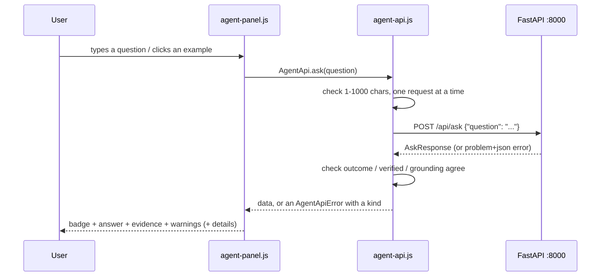

# Dashboard assistant (Stage 9)

Every dashboard page (`home.html`, `index.html`, `q2-offensive-vs-success.html`, `q3-disciplinary.html`) now has an **Ask the analyst** button in the bottom-right corner. It opens a side panel that sends the question to the FastAPI backend and shows the answer, whether it passed the fact check, the evidence and any data warnings. The panel doesn't block the page, so the D3 charts keep working while it's open, and the charts work exactly as before when the backend isn't running.

The browser never calculates a statistic. Every number in the panel comes from the backend's deterministic tools, and the panel only displays it.



## Files

| file | role |
|---|---|
| `frontend/src/agent-api.js` | API client (`window.AgentApi`): validation, the request, timeout and cancel, error kinds, response checks, readiness check |
| `frontend/src/agent-panel.js` | The panel (`window.AgentPanel`): launcher, form, example questions, rendering, status indicator |
| `frontend/src/agent-panel.css` | Styles, built from the dashboard's own theme tokens, so light and dark mode follow the existing toggle |
| `frontend/src/chart-actions.js` | Unchanged stub. Chart actions are shown as suggestions only (see below). |

Each page loads `agent-panel.css`, `chart-actions.js`, `agent-api.js` and `agent-panel.js` at the end of `<body>`, after the page's own scripts. `main.js`, `q2-chart.js`, `q3-chart.js`, `data-loader.js` and the datasets are untouched.

## Configuration

The API base URL defaults to `http://127.0.0.1:8000`. To point the panel somewhere else, set `window.AGENT_API_BASE` in a script that runs before `agent-api.js`:

```html
<script>window.AGENT_API_BASE = "http://127.0.0.1:8001";</script>
```

There are no credentials in the frontend. The client never logs the question or the response. When a request fails, it logs `[agent] request failed` with the error kind, the HTTP status and the request id. That id appears in the server log, so you can match the two up.

## Running it locally

1. Start the backend from `agent-backend` with the venv active:
   ```powershell
   python -m uvicorn app.main:create_app --factory --port 8000
   ```
   Check it at http://127.0.0.1:8000/health/ready.
2. In WebStorm, open `frontend/home.html` and press **Debug** (or the browser icon). WebStorm serves the page from `http://localhost:63342/...`, which is in the backend's default `CORS_ORIGINS`.
3. Click **Ask the analyst**, then click an example or type a question.

## What each outcome looks like

| outcome | badge | how the answer is shown |
|---|---|---|
| verified | ✓ Verified (green) | Normal answer, plus "Every figure in this answer was checked against the tool results." |
| no_evidence | No evidence | The backend's safe answer and "The available data could not answer this question, so no statistics are given." Tool errors (for example "Unknown team 'Arsenl'. Suggestions: Arsenal…") are listed. |
| fallback | Fallback (amber) | The tools' own summaries, with an amber edge. The note says the written answer failed the fact check. The rejected draft is never shown, because the backend doesn't return it. |
| unverified | ⚠ Unverified (red) | Italic, muted answer with an amber edge and the explicit caution. The grounding issues are listed under "Analysis details". |

The panel also shows:

- **Key stats** as tiles, when the answer has any.
- **Evidence** as a list.
- **Data warnings** (for example "Serie A 2018-19 is incomplete…"), always visible whatever the outcome.
- **Analysis details**, collapsed by default: question type, analysts, grounding (claims checked, unsupported claims), retries, time, language model, request id, problems along the way, tool calls, the raw tool output and the workflow steps.

Before anything is displayed, the client checks the response. The outcome must be one of the four above, the answer must not be empty, and `verified` and `grounding.passed` must agree with the outcome. If any check fails, the panel shows "Result not shown" with the request id rather than an answer.

All text from the backend is inserted with `textContent`. HTML or script in an answer is shown as plain text and never executed; a test checks this.

## Errors

| what happened | what the panel says |
|---|---|
| empty, whitespace-only or over-1000-character question | message under the box; nothing is sent |
| backend not running, or this page's origin not allowed | "Backend not reachable" with the start command and a CORS_ORIGINS hint; the status shows "Backend offline" |
| no answer after 60 s | "Took too long"; you can try again |
| Cancel pressed | "Cancelled" |
| 422 / 413 | "The question was not accepted: …", using the backend's own reason |
| 5xx | "The service reported a problem", with the request id |
| unreadable or inconsistent response | "Unreadable response" or "Result not shown", with the request id |

While a question is running, the Ask button and the example buttons are disabled and the status line counts the seconds. A second submission (click, Ctrl+Enter or code) is ignored. The client also refuses a second request while one is in progress.

The status indicator calls `/health/ready` when the panel is first opened, and again only when you click "Check service". There's a 5-second minimum between checks. That endpoint never calls the LLM or a tool.

### Connection or CORS problems

- **"Backend not reachable" while the server is running:** the page's origin isn't allowed. Look at the address bar. WebStorm uses `http://localhost:63342`; another tool might use, say, `http://localhost:5500`. Add the origin to `CORS_ORIGINS` in `agent-backend/.env` (comma-separated) and restart uvicorn. The browser console will show a CORS error for the blocked request.
- **The status stays "Not ready":** open http://127.0.0.1:8000/health/ready and read `checks.dataset`.
- **To match a failure to the server log,** use the request id shown in the panel; the uvicorn log line `football_api ask request_id=…` has the same id.

## Chart actions

`chart_actions` from the backend are listed as **Suggested chart views**, each with a plain link to the page, for example "Attack (Q2) · x = AvgShots · all leagues". Nothing on the page is changed automatically, and nothing the backend sends is executed. In offline-mock mode the backend never returns chart actions. Applying them to the charts (`chart-actions.js`) is left for a later stage.

## Offline-mock limits

With `USE_MOCK_LLM=true` (the default), keyword rules pick one tool per analyst and the answer is the tool's own summary. The examples in the panel are questions these rules answer properly:

- COVID home advantage in Serie A;
- shots vs points;
- yellow cards;
- red cards in La Liga;
- goals in the Bundesliga.

Other questions can come back **verified but unhelpful**:

- Team-specific questions such as "Compare Arsenal and Chelsea…" get league-wide correlations, because offline mode has no team lookup.
- "Who won the Premier League in 2004-05?" returns the table with no written summary.

That label is accurate, because everything shown is grounded; the answer just doesn't address the question. The real LLM in a later stage fixes this.

## Tests

`agent-backend/tests/test_frontend_agent.py` (34 tests) drives the real pages in headless Chromium with Playwright, which is already in the `dev` extra. It covers:

- the client: request shape, validation, 422, 500, network failure, unreadable and inconsistent responses, timeout, duplicate requests, logging;
- rendering of all four outcomes, using real backend responses;
- the XSS check;
- double submit and cancel, example questions, the status indicator;
- a full run against a real uvicorn backend;
- a blocked CORS origin;
- a check that the Q2 D3 chart still renders and reacts to its filter;
- every page loading the panel without errors.

```powershell
python -m playwright install chromium     # once
python -m pytest tests/test_frontend_agent.py -v
python -m pytest
```

If Chromium isn't installed, these tests are reported as skipped, with the install command. CI installs it.