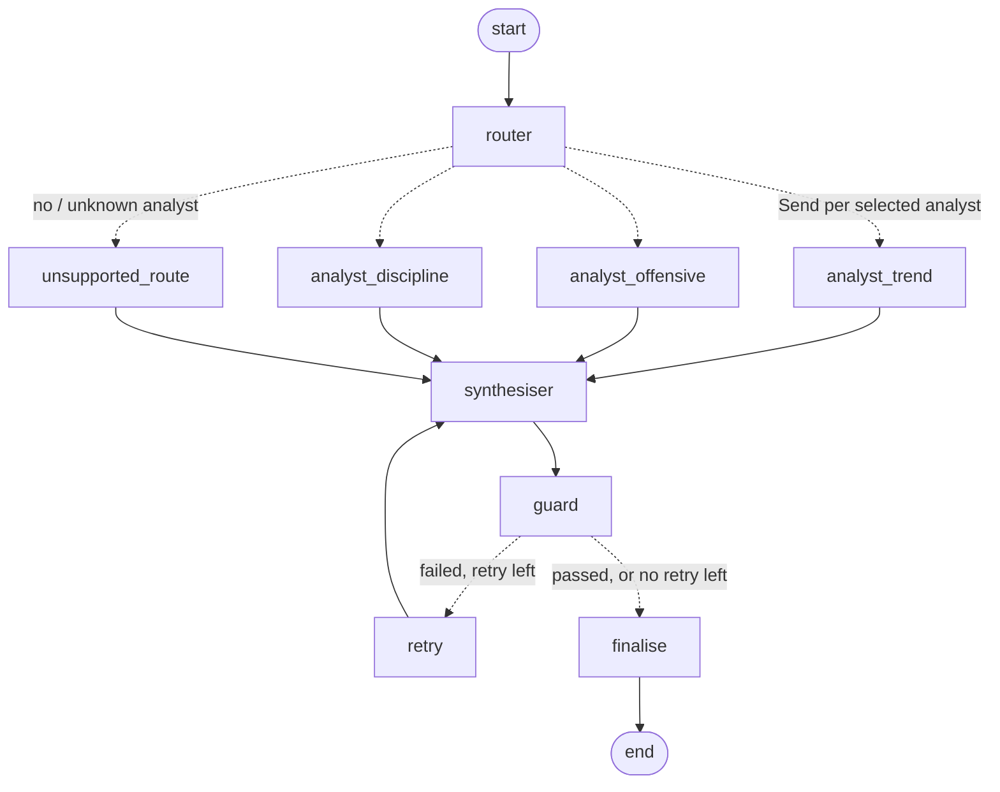

# Graph workflow (Stage 7)

`agent-backend/agents/graph.py` wires the existing nodes into one LangGraph `StateGraph`. The graph itself doesn't analyse anything. It never calls a tool or an LLM and never computes a number. It only decides which node runs next, keeps the retry loop bounded and records how the run ended.



You can regenerate this diagram from the compiled graph with `python -m agents.graph --mermaid`.

## Routing

The router node (LLM, with the rule-based router as its fallback) sets `intent` and `selected_agents`. `select_analysts` then sends the state to each selected analyst with LangGraph's `Send`, so they all run in the same step and the synthesiser runs once, after all of them.

Each intent goes to its own analyst when the router names nothing more specific:

| intent | default analyst(s) |
|---|---|
| trend | trend |
| offensive | offensive |
| discipline | discipline |
| comparison | trend (team_comparison, head_to_head) |
| hypothesis | trend (home_advantage_test, hypothesis_test) |
| general_statistics | trend (league_table, top_n, team_season_stats) |

If the question mentions shots or cards, the rule-based router picks the specialists instead. For example, "compare Arsenal and Chelsea on yellow cards and shots" goes to offensive and discipline. The LLM router can choose several analysts directly.

The router already validates its output, so unknown analysts never get through. As a second line of defence, if `selected_agents` is ever empty or names something that doesn't exist, the graph doesn't guess. It routes to `unsupported_route`, which records an `unsupported_route` error. The synthesiser then returns the no-evidence answer, or answers from whichever valid analysts did run.

## State

Every node returns only the keys it changes. The parallel-written keys `tool_calls`, `tool_results`, `token_usage`, `errors` and `node_trace` use `operator.add` reducers, so two analysts in the same step append rather than overwrite, and errors from early nodes are still there at the end. Two fields are new in Stage 7:

- `outcome` is set once by `finalise`: `verified`, `no_evidence`, `fallback` or `unverified`.
- `node_trace` holds one `{node, status, ms}` record per node run. Together with `token_usage` it gives per-node latency, which is groundwork for MLflow/Phoenix later.

## Grounding and the retry

After the guard runs, `after_guard` decides:

- Passed: go to `finalise`, and the outcome is `verified` (or `no_evidence` if no tool succeeded).
- Failed, with tool evidence and a retry left: go to `retry`, which bumps `retry_count` and records a `grounding_rejected` error. The synthesiser runs again with the guard's feedback (it reads `grounding_result`). The analysts and tools do not run again; the retry reuses the evidence already collected.
- Failed with no retry left, or failed with no tool evidence (the no-evidence draft is deterministic, so a retry would only repeat it): go to `finalise`.

There is at most one retry. `MAX_SYNTHESIS_RETRIES = 1` is a hard cap, and `state["max_retries"]` can only lower it, so 0 disables the retry. That means at most two synthesis attempts.

When the last draft still fails, `finalise` never shows it. It swaps in the synthesiser's deterministic `fallback_draft`, which reports the tools' own interpretation text and warnings, runs the guard on that, and records a `grounding_failed` error. Chart actions from the rejected draft are dropped. If the fallback passes, the outcome is `fallback`. If it somehow fails too, the outcome is `unverified`, `grounding_result.passed` stays false and the explanation says the answer couldn't be verified. Either way, `grounding_result` always describes the `draft_answer` actually returned, and `passed` is never true for a draft that failed.

## When something breaks

LLM failures are handled inside the nodes, the same as before:

- Router: falls back to the rule-based route.
- Analyst: records the error and returns no results.
- Synthesiser: deterministic fallback.
- Guard: fails closed.

Failed tools stay in `tool_results` with `ok=False`. The synthesiser refuses key stats that cite them, and the guard never treats them as evidence.

On top of that, each node runs inside `_node()`. If a node raises something unexpected (a bug rather than an `LLMError`), the exception is recorded as a `node_exception` error, `node_trace` marks the node `error`, and the node's safe fallback is used. That means a rule-based route, no results, the fallback draft, a fail-closed guard, or the outcome `unverified`. The run still finishes, and the error is visible in the returned state.

`ask()` also passes `recursion_limit=20`. The longest legal run is 8 steps, so hitting that limit would mean a bug.

## Using it

```python
from agents.graph import ask, build_graph, stream
from llm.mock import MockLLM

app = build_graph(MockLLM({...}))      # one client for every role, or:
# build_graph(router_llm=small, analyst_llm=small, synthesiser_llm=strong)
final = ask(app, "Do teams that take more shots get more points?")
final["draft_answer"], final["outcome"], final["grounding_result"]["passed"]

for node, update in stream(app, question):   # node-by-node progress, for the API later
    ...
```

Pass `checkpointer=InMemorySaver()` to `build_graph` to keep every step of a run under a `thread_id`. `app.get_state_history(...)` then shows each draft, including rejected ones, which is handy for debugging and evals.

To try it without an API key, run `python -m agents.demo`. It runs six scripted scenarios: verified, retry, fallback, router down, two analysts and no evidence. The LLM replies are scripted, but every number comes from the real tools.

## Limitations

- Only mock LLMs exist so far. The Groq client is a later stage.
- The retry rewrites prose only. If the analysts picked the wrong tool, the retry can't fetch new evidence; it just falls back.
- Comparison, hypothesis and general-statistics questions rely on the trend analyst's toolset unless a specialist topic is mentioned. There's no dedicated comparison analyst.
- The guard's own limits from Stage 6 still apply (e.g. two teams in one clause, team aliases in prose).
- `node_trace` times are wall clock. The first run includes loading the CSVs (about 2 s).